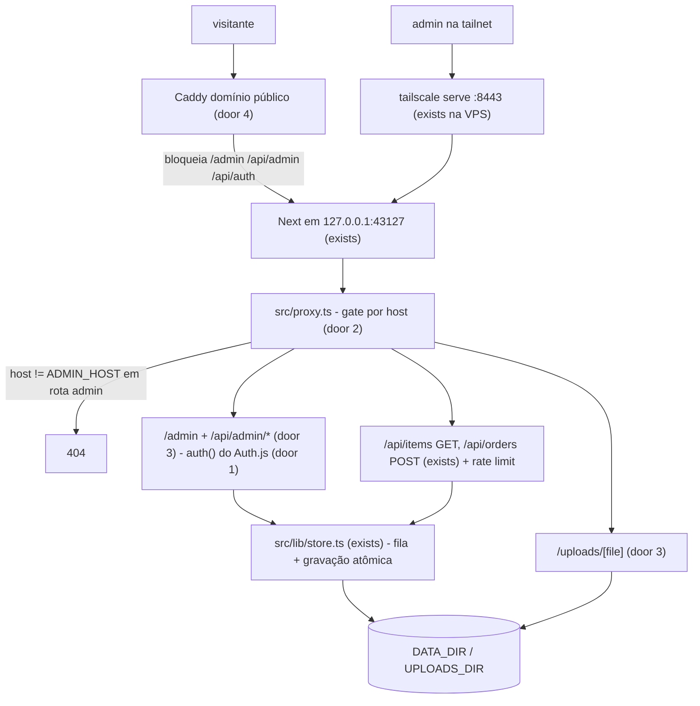

# Admin só pela VPN + proteções do site público

Sources:

- conversation (2026-10-30) - admin só pela Tailscale + login Google; site público só reserva/compra; proteções contra spam de reserva, corrida e perda de dados
- `harmonica-analytics/apps/web/src/auth.ts` - padrão de login Google a copiar (Auth.js v5, `ALLOWED_EMAILS`, sessão JWT)

## Problem

Hoje o painel `/admin` e todas as rotas de escrita (`POST/PATCH/DELETE /api/items`, `GET/PATCH /api/orders`, `POST /api/upload`) respondem a qualquer pessoa na internet; a única barreira é uma senha compartilhada (`x-admin-secret`) sem limite de tentativas, guardada em `localStorage`. Qualquer visitante consegue reservar todos os itens com telefones inventados e travar a loja por 24h, porque `POST /api/orders` não tem limite. Duas reservas simultâneas do mesmo item podem ser aceitas, porque o store lê, altera e regrava o JSON sem trava, e um processo que morra no meio de `fs.writeFile` deixa o JSON truncado e o site fora do ar. Os dados vivem em `data/*.json` versionados no git, então um `git pull` no servidor sobrescreve pedidos reais. Nenhuma evidência de incidente: o site ainda não foi publicado.

Quando isso entrar: o público só vê a vitrine e consegue reservar; o painel só abre para quem está na tailnet e logou com um Google autorizado; spam de reserva, reserva dupla e JSON corrompido deixam de ser possíveis.

## Out of scope

| Excluded | Why |
| --- | --- |
| Executar o deploy na VPS (Caddy, DNS, `tailscale serve`, cron de backup) | Exige go-ahead explícito para ação remota; este plano entrega os artefatos (Dockerfile, compose, Caddyfile, guia) e o deploy vira o passo seguinte |
| Banco de dados / Vercel / Cloudflare | Decidido: VPS com disco persistente |
| Captcha / Turnstile na reserva | Rate limit + 1 pendente por telefone cobrem o abuso esperado num desapega; revisitar se houver spam real |
| Papéis diferentes de admin | Todo e-mail autorizado é admin, igual ao harmonica-analytics |
| Rate limit nas rotas de admin | Com VPN + Google não há senha para força bruta; o limite de admin perdeu o motivo |

## Assumptions

| Assumption | Chosen default | Rationale | Confirmed? |
| --- | --- | --- | --- |
| VPN | Tailscale, mesma VPS do harmonica-analytics | resposta do usuário | y |
| Autenticação do admin | Tailscale + login Google (Auth.js v5, client OAuth novo), sem senha | resposta do usuário | y |
| Site público | domínio próprio servido por Caddy com HTTPS | resposta do usuário | y |
| Porta do admin na tailnet | `tailscale serve --https=8443` → `127.0.0.1:43127`, sem Funnel | a 443 da tailnet já é do harmonica-analytics (Funnel); 8443 sem Funnel fica só na tailnet | n |
| Como o app distingue admin de público | host da requisição (`ADMIN_HOST`, ex. `harmonica-analytics.tail4f62e1.ts.net:8443`); qualquer outro host recebe 404 em rotas de admin | o app escuta só em `127.0.0.1`; só o Caddy (host público) e o `tailscale serve` (host da tailnet) chegam nele, e cada um fixa o próprio Host | n |
| Limite de reservas por IP | 5 `POST /api/orders` por IP por hora; o 6º recebe 429 | um comprador real faz 1–3; 5 dá folga para erro de digitação | n |
| Reserva pendente por telefone | no máximo 1 reserva `pending` por telefone; a 2ª recebe 409 | impede travar vários itens com o mesmo número | n |
| IP do cliente | primeiro valor de `x-forwarded-for` (o Caddy sobrescreve esse cabeçalho); sem cabeçalho, `"local"` | Caddy por padrão ignora `X-Forwarded-For` vindo de fora e escreve o IP real | n |
| Armazenamento do rate limit | memória do processo (janela fixa) | um processo só; reiniciar zera o contador, aceitável | n |
| Diretório de dados | `DATA_DIR` (padrão `./data`); uploads em `UPLOADS_DIR` (padrão `<DATA_DIR>/uploads`) | no servidor apontam para `/var/lib/desapega` fora do repositório | n |
| URL das fotos enviadas | continua `/uploads/<arquivo>`, agora servida por rota que lê `UPLOADS_DIR` | não muda o formato salvo em `items.json` | n |
| Fotos semente | `public/items/**` continuam no repositório e servidas pelo Next | são parte do catálogo inicial versionado | n |
| Runner de teste | Vitest | o repo não tem testes; Vitest roda TypeScript e o alias `@/` sem build | n |
| Domínio público | `desapega.useclubapp.com` (zona `useclubapp.com` na Cloudflare da Beatriz), registro A para a VPS | domínio informado pelo usuário; subdomínio não mexe no que já existe na raiz | n |
| Proxy da Cloudflare | registro em modo "DNS only" (nuvem cinza); Caddy emite o certificado Let's Encrypt | com a nuvem laranja o Caddy veria o IP da Cloudflare e o rate limit por IP bloquearia todos juntos | n |
| E-mails do admin | `ALLOWED_EMAILS=filipemlins@gmail.com,beatrizbisol@gmail.com` | informado pelo usuário | y |

**Open questions:**

| # | Kind | Question | Until answered |
| --- | --- | --- | --- |
| 1 | blocks go-live | Client OAuth Google novo (ID/secret) com redirect `https://<ADMIN_HOST>/api/auth/callback/google` | login Google não funciona |

## Criteria

### S1: Admin só pela tailnet e com Google (P1)

**Acceptance Criteria**

1. IF uma requisição para `/admin`, `/admin/*`, `/api/admin/*` ou `/api/auth/*` chega com host diferente de `ADMIN_HOST` THEN the system SHALL responder 404
2. IF `ADMIN_HOST` não está definido THEN the system SHALL responder 404 em todas as rotas do item 1
3. WHEN uma requisição para `/admin` chega pelo `ADMIN_HOST` sem sessão THEN the system SHALL redirecionar para `/admin/login`
4. IF uma requisição para `/api/admin/*` chega pelo `ADMIN_HOST` sem sessão THEN the system SHALL responder 401 com `{ "error": "Não autorizado." }`
5. IF o e-mail do Google não está em `ALLOWED_EMAILS` (comparação sem diferenciar maiúsculas) THEN the system SHALL recusar o login
6. IF `ALLOWED_EMAILS` está vazio THEN the system SHALL recusar todo login
7. The system SHALL expor as operações de escrita só em `/api/admin/*`: `POST /api/admin/items`, `PATCH|DELETE /api/admin/items/[id]`, `GET /api/admin/orders`, `PATCH /api/admin/orders/[id]`, `POST /api/admin/upload`
8. The system SHALL responder 405 a `POST`, `PATCH` e `DELETE` em `/api/items` e `/api/items/[id]`, e a `GET` em `/api/orders`
9. The system SHALL não ler `ADMIN_SECRET` nem o cabeçalho `x-admin-secret` em lugar nenhum

**Independent test:** com `ADMIN_HOST=admin.test`, `GET /admin` com `Host: site.test` → 404; com `Host: admin.test` sem cookie → redirect `/admin/login`; `POST /api/admin/items` com `Host: admin.test` sem cookie → 401.

### S2: Reserva pública protegida (P1)

**Acceptance Criteria**

10. IF o mesmo IP faz mais de 5 `POST /api/orders` em 60 minutos THEN the system SHALL responder 429 com `{ "error": "Muitas tentativas. Tente de novo mais tarde." }` e cabeçalho `Retry-After` em segundos
11. IF já existe uma reserva `pending` com o mesmo telefone (só dígitos) THEN the system SHALL responder 409 com `{ "error": "Já existe uma reserva pendente para este telefone." }` e não criar o pedido
12. WHEN duas reservas do mesmo item disponível chegam ao mesmo tempo THEN the system SHALL aceitar exatamente uma (201) e responder 409 à outra
13. WHEN uma reserva expira (24h) ou é cancelada THEN the system SHALL deixar o telefone livre para nova reserva

**Independent test:** 6 `POST /api/orders` seguidos do mesmo `x-forwarded-for` → o 6º é 429; dois `createOrder` em `Promise.all` no mesmo item → um sucesso, um `ITEM_UNAVAILABLE`.

### S3: Dados que não se perdem (P1)

**Acceptance Criteria**

14. The system SHALL ler e gravar `items.json` e `orders.json` em `DATA_DIR` (padrão `./data`)
15. The system SHALL gravar cada JSON num arquivo temporário no mesmo diretório e renomeá-lo sobre o destino, de modo que o destino sempre contém um JSON completo
16. WHILE uma operação de escrita do store está em andamento the system SHALL enfileirar as demais, de modo que N escritas concorrentes resultem em N alterações aplicadas
17. WHEN o admin envia uma foto THEN the system SHALL gravá-la em `UPLOADS_DIR` (padrão `<DATA_DIR>/uploads`) e devolver `/uploads/<arquivo>`
18. WHEN alguém pede `GET /uploads/<arquivo>` de um arquivo existente THEN the system SHALL responder 200 com o `Content-Type` da extensão
19. IF o nome pedido em `/uploads/` não casa `^[0-9]+-[0-9a-f]{8}\.(jpg|png|webp|gif)$` ou o arquivo não existe THEN the system SHALL responder 404

**Independent test:** 20 `createItem` em `Promise.all` → `items.json` tem os 20; upload e depois `GET /uploads/<nome>` → 200; `GET /uploads/..%2Fitems.json` → 404.

### S4: Pronto para a VPS (P2)

**Acceptance Criteria**

23. WHERE `CLIENT_IP_HEADER` está definido the system SHALL usar só esse cabeçalho como IP do cliente no limite de reservas, ignorando `X-Forwarded-For`
24. WHEN o site está publicado THEN the system SHALL responder 200 em `https://desapega.useclubapp.com/api/items` e bloquear `/admin`, `/api/admin/orders` e `/api/auth/providers` nesse host (403 do WAF ou 404 do app)

20. The system SHALL incluir `Dockerfile` e `docker-compose.prod.yml` que publicam o app só em `127.0.0.1:43127` e montam `DATA_DIR` num volume do host
21. The system SHALL incluir um `Caddyfile` de exemplo que serve o domínio público com HTTPS e responde 404 para `/admin*`, `/api/admin*` e `/api/auth*`
22. The system SHALL documentar em `docs/DEPLOY.md` as variáveis (`ADMIN_HOST`, `AUTH_SECRET`, `AUTH_URL`, `AUTH_GOOGLE_ID`, `AUTH_GOOGLE_SECRET`, `ALLOWED_EMAILS`, `DATA_DIR`, `UPLOADS_DIR`), o comando `tailscale serve` e o cron de backup de hora em hora

**Independent test:** `docker compose -f docker-compose.prod.yml config` sai 0; `caddy validate` (ou `caddy adapt`) no Caddyfile sai 0.

## Traceability

| ID | Slice | Criteria | Status |
| --- | --- | --- | --- |
| ADM-01 | S1 | 1, 2, 3, 4, 5, 6, 7, 8, 9 | Pending |
| PUB-01 | S2 | 10, 11, 12, 13 | Pending |
| DATA-01 | S3 | 14, 15, 16, 17, 18, 19 | Pending |
| OPS-01 | S4 | 20, 21, 22, 23, 24 | Pending |

## Observable

| Surface | Decision | Landing |
| --- | --- | --- |
| screen `/admin/login` | estado vazio / inicial | AC 3 - botão "Entrar com Google" |
| screen `/admin/login` | erro (e-mail não autorizado) | AC 5 - mensagem "Este e-mail não tem acesso." |
| screen `/admin/login` | carregando | n/a - redirect do Google é navegação de página inteira |
| screen `/admin` | não autorizado | AC 3 |
| screen `/admin` | vazio / carregando / erro | existing - `admin-panel.tsx` já trata lista vazia e erro de fetch |
| screen `/admin` | ação destrutiva confirma | existing - padrão atual do painel ao excluir item |
| screen `/admin` | sair | AC 3 - botão "Sair" substitui o campo de senha |
| screen reserva (`buy-dialog`) | erro 429 / 409 | AC 10, AC 11 - mostra o `error` da resposta, como já faz com 409 de item indisponível |
| API `/api/admin/*` | quem chama | AC 1, AC 4 |
| API `/api/admin/*` | formato de erro | existing - `{ "error": string }` usado em todas as rotas |
| API `POST /api/orders` | limite | AC 10 |
| API `POST /api/orders` | formato de erro | existing - `{ "error": string }` |
| API `GET /uploads/<arquivo>` | quem chama / erro | AC 18, AC 19 |
| API (todas) | versionamento | n/a - só o próprio front consome |
| document `docs/DEPLOY.md` | estrutura e próximo passo do leitor | AC 22 |

## Flow

Reaproveita o store em JSON (`src/lib/store.ts`), o formato `{ error }` das rotas e o padrão de auth do harmonica-analytics; não cria banco nem segundo app.

## Relations

None - os formatos de `Item` e `Order` não mudam; só muda onde os arquivos ficam.

## Surface

| Route | In | Out | Status |
| --- | --- | --- | --- |
| `POST /api/orders` | `itemId`, `buyerName`, `buyerPhone`, `paymentMethod`, `deliveryMethod` | `Order` · `{ error }` | `201`, `400`, `404`, `409`, `429`, `500` |
| `GET /api/orders` | - | `{ error }` | `405` |
| `GET /api/items` | - | `Item[]` | `200` |
| `POST /api/items` | - | - | `405` |
| `GET /api/items/[id]` | `id` | `Item` · `{ error }` | `200`, `404` |
| `PATCH /api/items/[id]` | - | - | `405` |
| `DELETE /api/items/[id]` | - | - | `405` |
| `POST /api/admin/items` | `title`, `description`, `price`, `photos` | `Item` · `{ error }` | `201`, `400`, `401`, `404`, `500` |
| `PATCH /api/admin/items/[id]` | campos parciais de `Item` | `Item` · `{ error }` | `200`, `400`, `401`, `404`, `500` |
| `DELETE /api/admin/items/[id]` | `id` | `{ ok }` · `{ error }` | `200`, `401`, `404`, `500` |
| `GET /api/admin/orders` | - | `Order[]` · `{ error }` | `200`, `401`, `404`, `500` |
| `PATCH /api/admin/orders/[id]` | `status` | `Order` · `{ error }` | `200`, `400`, `401`, `404`, `500` |
| `POST /api/admin/upload` | `file` (multipart) | `{ url }` · `{ error }` | `201`, `400`, `401`, `404`, `500` |
| `GET /uploads/[file]` | `file` | bytes da imagem | `200`, `404` |
| `PATCH /api/admin/orders/[id]` (transição inválida, achado P1 do review) | `status` | `{ error }` | `409` |
| `GET,POST /api/auth/*` | fluxo OAuth do Auth.js | redirects / sessão | `200`, `302`, `404` |

## Landing

| One-way door | Literal shape | Alternative rejected |
| --- | --- | --- |
| 1. Dependência de auth | `next-auth@5.0.0-beta.32` com `Google()`, `session: { strategy: "jwt" }`, `callbacks.signIn` checando `ALLOWED_EMAILS` - igual a `harmonica-analytics/apps/web/src/auth.ts` | oauth2-proxy na frente: mais um processo e config fora do repo; Auth.js já é o padrão que o usuário conhece |
| 2. Gate por host | `src/proxy.ts` com `matcher: ["/admin/:path*", "/api/admin/:path*", "/api/auth/:path*"]`, `404` quando `request.headers.get("host") !== process.env.ADMIN_HOST` | gate por IP 100.64.0.0/10: atrás do `tailscale serve` o app vê `127.0.0.1` como origem, então o IP não distingue tailnet de Caddy |
| 3. Rotas novas consumidas pelo front | prefixo `/api/admin/*` para escrita; `/uploads/[file]` servido por route handler lendo `UPLOADS_DIR` | manter as rotas atuais e filtrar por método no Caddy: o bloqueio dependeria de regra por método e verbo, fácil de errar no próximo endpoint |
| 4. Topologia de deploy | app em Docker publicado em `127.0.0.1:43127`; Caddy no host para o domínio; `tailscale serve --bg --https=8443 http://127.0.0.1:43127` para admin | Tailscale Funnel para o público: usuário escolheu domínio próprio |
| 5. Runner de teste | `vitest` como devDependency, script `"test": "vitest run"` | `node --test`: não resolve o alias `@/` sem loader extra |

| 6. Entrada pública por Cloudflare Tunnel (supera a parte "Caddy no host" do door 4; decidido pelo usuário em 2026-10-30 ao ver a VPS) | serviço `tunnel` (`cloudflare/cloudflared`) no `docker-compose.prod.yml` com `TUNNEL_TOKEN`; hostname público `desapega.useclubapp.com` → `web:43127`; regra WAF bloqueando `/admin`, `/api/admin`, `/api/auth` nesse host; `CLIENT_IP_HEADER=cf-connecting-ip` | Caddy no host com nuvem cinza: a 443 pública já é do Caddy do harmonica-api e o ufw só aceita IPs da Cloudflare ("origin lockdown"); pendurar no Caddy do harmonica-api: edita e reinicia o proxy de produção de outros apps |

| 7. Postgres como store (pedido do usuário em 2026-10-30) | serviço `db` (`postgres:16-alpine`) no compose; tabelas `items` (id `text`, preserva slugs da semente) e `orders` (id `uuid`); índices únicos parciais `orders_one_pending_per_item` e `orders_one_pending_per_phone` em `WHERE status = 'pending'`; semente de `SEED_ITEMS_PATH` quando `items` está vazia | JSON em disco (ADR 0001): usuário pediu banco; SQLite: usuário escolheu Postgres |
| 8. Fotos no R2 | uploads do admin com `R2_*` vão para `uploads/<arquivo>` no bucket; fotos da semente servidas de `MEDIA_BASE_URL` (`https://media.useclubapp.com`) | disco da VPS: usuário pediu R2 como no site do Eberienos |
| 9. Paginação por cursor | `GET /api/items` e `GET /api/admin/orders` aceitam `limit` (1–100, padrão 20), `cursor`, `status`; respondem `{ items | orders, nextCursor }` | offset/página: duplica ou pula linhas quando entram itens novos entre páginas |

- Nothing else in this change is hard to reverse

## Impact

| Front | What changes |
| --- | --- |
| domain | `ADMIN_SECRET` deixa de existir; acesso admin = sessão Google + host da tailnet |
| domain | novo termo: `ADMIN_HOST` - host pelo qual o painel é servido, vive em `src/proxy.ts` |
| front | `admin-panel.tsx` passa a chamar `/api/admin/*` com cookie de sessão e perde campo de senha e `localStorage`; `buy-dialog.tsx` continua em `POST /api/orders` |
| stored data | nada a migrar no formato; no servidor `data/items.json` é copiado uma vez para `DATA_DIR`; `public/uploads/` sai do repositório (só tinha `.gitkeep`) |
